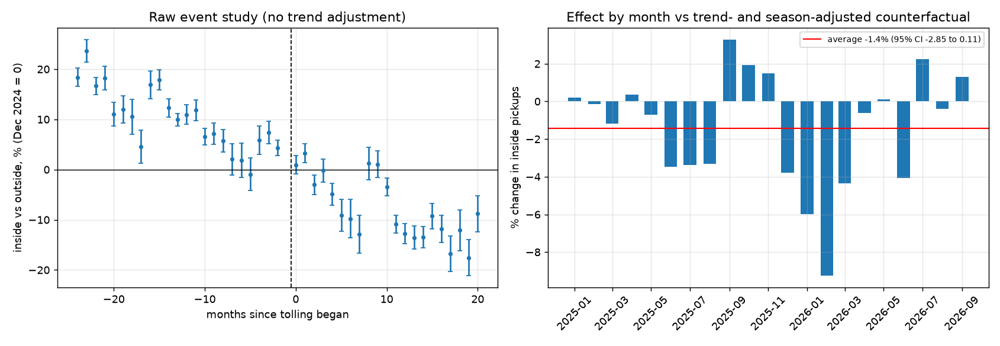
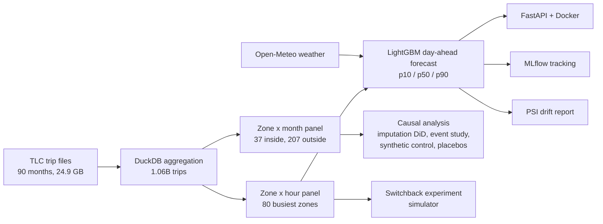

# Did NYC congestion pricing cut Uber/Lyft trips?

A causal-inference and forecasting study of **1.06 billion NYC taxi and Uber/Lyft trips** around Manhattan's
congestion pricing, which began on 5 January 2025.

[](https://github.com/gss-18/nyc-congestion/actions/workflows/ci.yml)


**[Read the visual case study →](https://gss-18.github.io/nyc-congestion/site/)**



## Three results

> **−15.9%** is what a naive before/after comparison says happened to Uber/Lyft pickups inside the zone.

> **−1.4%** is the estimate once the pre-existing trend and seasonality are modelled. For total trips the 95%
> interval is **−2.9% to +0.1%**, so the effect is not statistically distinguishable from zero.

> **11.7%** day-ahead hourly forecast error (WAPE) across 80 zones, against 15.5% for the best baseline.

## Why the naive answer is wrong

Inside-zone Uber/Lyft trips had been falling about **8% a year** relative to the rest of the city since the start of
2023, two years before tolling. A before/after comparison credits that whole decline to the toll. The left chart
above shows it: a steady downward slope that runs straight through January 2025 with no break.

The main estimator (imputation difference-in-differences, Borusyak, Jaravel & Spiess 2024) learns that trend and the
zone's own seasonal pattern from the pre-policy months only, predicts what would have happened without tolling, and
compares. Two checks keep it honest:

- **Placebo in time:** the same method on a fake policy date (July 2024) finds −0.2% (interval −1.3% to +0.9%).
- **Tested on fake data:** it recovers a known effect despite a pre-trend, while the naive version overstates it.

**Two ways to average.** Total trips across the zone fell 1.4% (interval −2.9% to +0.1%). The average zone fell 1.7%
(interval −3.0% to −0.3%). The first answers the policy question (how many fewer trips?); the second weights a quiet
zone the same as Times Square. Context: the average Uber/Lyft trip from the zone cost $34.21 before fees in 2025, so
the $1.50 fee is about 4% of the fare.

## How it fits together



The tolled zones are identified from the data: zones where 95-99% of local Uber/Lyft trips paid the congestion fee
are inside; six zones straddling 60th Street (14-49%) are set aside.

## Results

| Analysis | Result |
|---|---|
| Naive comparison | −15.9% |
| **Imputation DiD, trend + seasonality: total trips** | **−1.4%** (−2.9% to +0.1%) |
| Same model, average zone | −1.7% (−3.0% to −0.3%) |
| Placebo, fake policy July 2024 | −0.2% (−1.3% to +0.9%) |
| Synthetic control (weekly) | −5.8%, not significant (placebo p = 0.39) |
| Off-peak / peak pickups | −2.5% (−4.0% to −0.7%) / −1.0% (−2.4% to +0.4%) |
| Border-zone spillover | −1.4% (−4.3% to +1.6%) |
| Forecast WAPE, Apr-Sep 2026 backtest | 11.7% (baselines: 15.5%, 22.9%, 23.6%) |
| p10-p90 interval coverage | 78.8% (target 80%) |
| Best switchback design for a 2% price test | 4-hour blocks + hour-of-week fixed effects + 1-hour burn-in |

Intervals are 95%, from 1,000 bootstrap resamples of zones. Full numbers and charts: [docs/LEARN.md](docs/LEARN.md).

## Repository map

| Path | What it does |
|---|---|
| `scripts/download_data.py`, `download_weather.py` | Fetch TLC trip files and hourly weather |
| `scripts/derive_zones.py`, `src/nyc_congestion/zones.py` | Identify tolled zones from the fee charged |
| `scripts/aggregate.py` | DuckDB: 1.06B trips to hourly zone tables |
| `src/nyc_congestion/causal.py`, `scripts/causal_analysis.py` | Imputation DiD, event study, synthetic control, bootstrap, placebos |
| `src/nyc_congestion/forecast.py`, `scripts/forecast.py` | Features (24-hour rule), LightGBM, rolling backtest, MLflow |
| `src/nyc_congestion/switchback.py`, `scripts/switchback_study.py` | Switchback design simulation on real demand |
| `src/nyc_congestion/drift.py`, `scripts/drift_report.py` | PSI drift monitoring vs the same month a year earlier |
| `src/nyc_congestion/api.py`, `Dockerfile` | Forecast API |
| `docs/site/` | One-page visual case study |
| `tests/` | 19 tests, including estimators checked on fake data and leakage checks |

## Inspect it quickly (no downloads)

- Read the case study page: https://gss-18.github.io/nyc-congestion/site/
- Read the methodology and every result: [docs/LEARN.md](docs/LEARN.md) and the [model card](docs/MODEL_CARD.md).
- Run the tests, which use small fake data:

```bash
uv sync && uv run pytest -q
```

## Reproduce everything

Needs about 25 GB of disk and runs on a 16 GB laptop.

```bash
uv sync
uv run python scripts/download_data.py        # ~25 GB, ~10 min
uv run python scripts/download_weather.py
uv run python scripts/aggregate.py            # ~4 min
uv run python scripts/causal_analysis.py      # ~25 min (1,000 bootstrap resamples per estimate)
uv run python scripts/forecast.py             # ~15 min
uv run python scripts/switchback_study.py
uv run python scripts/drift_report.py
uv run python scripts/export_site_data.py     # data for docs/site
uv run mlflow ui --backend-store-uri sqlite:///mlruns.db
```

## Forecast API

```bash
uv run uvicorn nyc_congestion.api:app        # docs at http://127.0.0.1:8000/docs
```

```http
GET /forecast?zone=161&date=2026-10-01
```

```json
{
  "zone": 161,
  "date": "2026-10-01",
  "weather_source": "monthly average (no forecast)",
  "hours": [
    {"hour": 8, "p50": 247.1, "p10": 205.2, "p90": 291.2},
    {"hour": 18, "p50": 691.4, "p10": 557.2, "p90": 797.9}
  ]
}
```

The API only forecasts the day after its latest data, because every feature must be at least 24 hours old.

## Limitations

- The trend adjustment extrapolates a straight line fitted to 2023-2024 for up to 21 months. Month-by-month effects
  swing between about −9% and +3%, so read the estimate as "small", not as a precise number.
- Yellow taxi trips grew 20-40% everywhere in 2025 for reasons unrelated to the toll, so the causal analysis
  focuses on Uber/Lyft.
- Taxi zones are coarse; effects right at the zone boundary are not measurable.
- The forecast uses recorded weather in backtests but average weather for future days.

## What I would improve in production

- Pull a live weather forecast instead of monthly averages.
- Retrain monthly when TLC publishes new data, with the drift report and backtest as automatic gates.
- Host the model behind a managed endpoint with request logging and alerting on live error.
- Calibrate PSI thresholds per feature; tightly clustered features alert too easily at 0.2.

## Data

NYC Taxi & Limousine Commission trip records (public): https://www.nyc.gov/site/tlc/about/tlc-trip-record-data.page
· Weather: Open-Meteo historical archive, https://open-meteo.com
