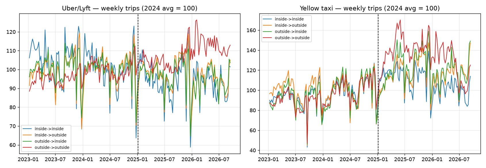
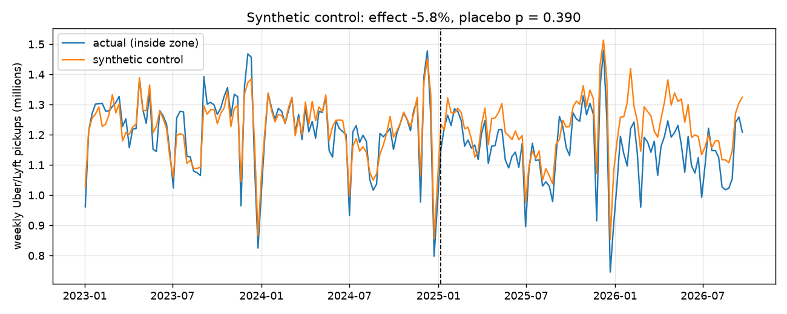
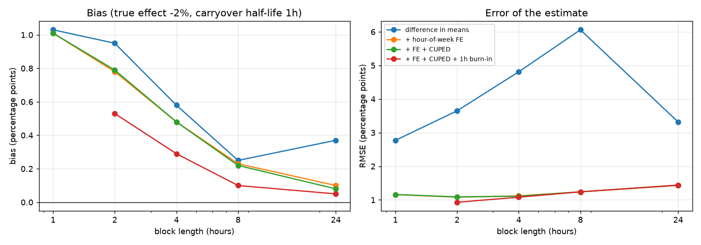
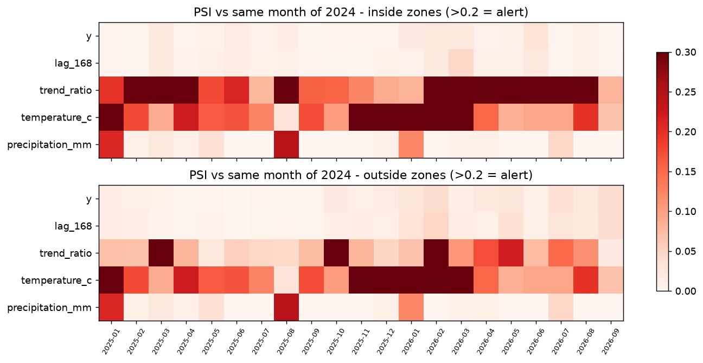

# Did NYC congestion pricing reduce Uber/Lyft trips?

A causal-inference and forecasting study on **1.06 billion NYC taxi and Uber/Lyft trips** (Jan 2023 - Sep 2026).
Manhattan's congestion pricing started on **5 January 2025**: Uber/Lyft trips in the zone pay a flat $1.50 fee.

## Key results

| Question | Answer |
|---|---|
| Naive estimate: inside-zone trips vs outside, before vs after | **-15.9%** |
| **After removing the pre-existing trend and seasonality** (imputation DiD, 95% CI from a zone bootstrap) | **-1.4%** (-2.7% to -0.1%) |
| Same method on a fake policy date (placebo) | -0.2% (CI includes 0): the method does not invent effects |
| Synthetic control | -5.8%, not significant (placebo p = 0.39) |
| Day-ahead hourly forecast error (WAPE), 80 zones | **11.7%** vs 15.5% for the best baseline |
| Best switchback design for a 2% price test | 4-hour blocks + hour-of-week FE + 1-hour burn-in |

**The headline is a cautionary one:** inside-zone Uber/Lyft trips had been falling about 8% a year relative to the
rest of the city since 2023. A simple before/after comparison credits that old decline to the toll. Once it is
modelled, the effect of the $1.50 fee on Uber/Lyft trips is small (about -1.4%) and not robust across methods.


## What is in here

| Part | Code | Notes |
|---|---|---|
| Data: TLC download, data-derived congestion zones, DuckDB aggregation of 1B rows | `scripts/download_data.py`, `derive_zones.py`, `aggregate.py` | zones identified from the fee actually charged, not a hand-drawn map |
| Causal: imputation DiD with group trend + seasonality, event study, synthetic control, placebos | `src/nyc_congestion/causal.py`, `scripts/causal_analysis.py` | estimators are tested on fake data with a known effect |
| Forecasting: LightGBM day-ahead, rolling-origin backtest, quantile intervals, MLflow | `forecast.py`, `scripts/forecast.py` | leakage tests enforce the 24-hour rule |
| Experimentation: switchback design simulator on real demand | `switchback.py`, `scripts/switchback_study.py` | bias, RMSE, CI coverage, power by block length |
| Monitoring: PSI drift report, same-month reference | `drift.py`, `scripts/drift_report.py` | |
| Serving: FastAPI + Docker, CI on GitHub Actions | `api.py`, `Dockerfile`, `.github/workflows/ci.yml` | |

Docs: [model card](docs/MODEL_CARD.md) · [step-by-step guide with all results](docs/LEARN.md)

## Reproduce

```bash
uv sync
uv run python scripts/download_data.py        # ~25 GB, ~10 min
uv run python scripts/download_weather.py
uv run python scripts/aggregate.py            # ~4 min
uv run python scripts/causal_analysis.py      # ~3 min
uv run python scripts/forecast.py             # ~15 min
uv run python scripts/switchback_study.py
uv run python scripts/drift_report.py
uv run uvicorn nyc_congestion.api:app         # http://127.0.0.1:8000/docs
uv run pytest -q
```

## More charts

| | |
|---|---|
|  |  |
|  |  |

## Data

NYC Taxi & Limousine Commission trip records (public): https://www.nyc.gov/site/tlc/about/tlc-trip-record-data.page ·
Weather: Open-Meteo historical archive (https://open-meteo.com).
